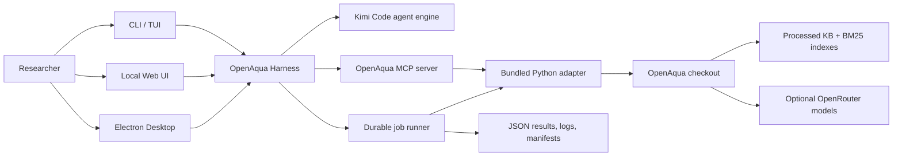

<p align="center">
  
</p>

<h1 align="center">OpenAqua Harness</h1>

<p align="center"><strong>Beta release · v0.1.0-beta.1</strong></p>

<p align="center">
  <strong>An agentic workbench for evidence-grounded, early-stage water-treatment train design.</strong>
</p>

<p align="center"><strong>English</strong> | <a href="./README.zh-CN.md">简体中文</a></p>

<p align="center">
  CLI, terminal UI, local Web UI, Electron desktop, MCP tools, durable jobs, and engineering provenance around the open-source <a href="https://github.com/zhaorui-bi/OpenAqua">OpenAqua</a> five-agent pipeline.
</p>

<p align="center">
  <a href="https://github.com/zhaorui-bi/OpenAqua-Harness/actions/workflows/ci.yml"></a>
  <a href="https://github.com/zhaorui-bi/OpenAqua-Harness/releases"></a>
  <a href="./LICENSE"></a>
  
  
</p>

<p align="center">
  
</p>

---

## What is OpenAqua Harness?

[OpenAqua](https://github.com/zhaorui-bi/OpenAqua) is an automated multi-agent
framework for early-stage water-treatment train design. Its typed workflow is:

```text
Task Parser → Retrieval → Planning → Critic → Explanation
```

OpenAqua Harness turns that Python research system into a complete local
workbench. It embeds the MIT-licensed
[Kimi Code](https://github.com/MoonshotAI/kimi-code) agent engine, exposes
OpenAqua through an MCP stdio server, and provides one product across terminal,
browser, and desktop interfaces.

### Highlights

| Capability | What it provides |
| --- | --- |
| **Five-agent workflow** | Query normalization, hybrid evidence retrieval, taxonomy-constrained planning, rule-based critique, and evidence-bound explanations. |
| **Focused MCP surface** | 16 tools for readiness, taxonomy, recommendation, retrieval, constraint checking, indexing, knowledge staging, WContBench evaluation, and durable job control. |
| **Three user interfaces** | Full terminal UI, lightweight CLI/REPL, local browser UI, and an Electron desktop shell backed by the same harness. |
| **Durable engineering jobs** | Long operations survive session closure and expose lifecycle state, bounded logs, output metadata, input hashes, payload hashes, and request fingerprints. |
| **Two model layers** | API-provider setup for the conversational agent, plus optional `OPENROUTER_API_KEY` support for OpenAqua’s parser/planner/explainer agents. |
| **Local-first security** | Private configuration, atomic writes, strict path handling, no shell command interpolation, bounded process output, and loopback-only authenticated Web serving by default. |

> [!IMPORTANT]
> OpenAqua recommendations are early-stage engineering decision support. They
> are not final process design, regulatory approval, a performance guarantee,
> or a substitute for expert review, treatability testing, pilot testing, and
> site-specific engineering.

## Architecture



OpenAqua source code and Hugging Face data are **not vendored** into this
repository. The bundled adapter provides a stable command contract over an
external OpenAqua checkout.

## Requirements

- Node.js **24.15.0 or newer**
- npm **12**
- Python **3.10 or newer** for the OpenAqua backend
- A local OpenAqua checkout for research operations
- Processed OpenAqua data and built indexes for taxonomy/retrieval/design
- macOS, Linux, or Windows

## Quick start

### 1. Install the Harness

```bash
git clone https://github.com/zhaorui-bi/OpenAqua-Harness.git
cd OpenAqua-Harness

npm ci
npm run setup
```

`npm run setup` installs the pinned engine workspace, builds the Harness, and
synchronizes the branded Web UI.

### 2. Install OpenAqua

```bash
git clone https://github.com/zhaorui-bi/OpenAqua.git
cd OpenAqua
git checkout 0e3990817946f1786828fabbfa9ba4bc06af96e8
cd water_treatment_agent

python3 -m venv .venv
source .venv/bin/activate                 # Windows: .venv\Scripts\activate
python -m pip install -r requirements.txt
```

Download the processed knowledge base and WContBench from
[Hugging Face](https://huggingface.co/datasets/zhaorui-bi/OpenAqua):

```bash
python -m pip install -U huggingface_hub
hf download zhaorui-bi/OpenAqua data.zip WContBench/ \
  --repo-type dataset \
  --revision cc2d3c620e8ada7c62fa922cf3a827d8b42889e3 \
  --local-dir ../hf_openaqua

unzip ../hf_openaqua/data.zip -d .
```

The archive already contains its top-level `data/` directory; extract it into
`water_treatment_agent`, not into an existing `data/` directory. The Git and
Hugging Face revisions above are the `0.1.0-beta.1` validation baseline; record
and revalidate both if you intentionally update them. Keep
`../hf_openaqua/WContBench/` for evaluation. `RawData.zip` is optional.

### 3. Configure both model layers

The Harness agent needs a chat model provider. OpenAqua itself can optionally
use OpenRouter; without it, OpenAqua uses its rule/template fallbacks.

```bash
# Optional OpenAqua backend LLMs
export OPENROUTER_API_KEY="..."
export OPENAQUA_OPENROUTER_MODEL="anthropic/claude-3.5-sonnet"  # optional shared override
# Granular alternatives: OPENAQUA_DEFAULT_MODEL,
# OPENAQUA_PLANNER_MODEL, and OPENAQUA_EXPLANATION_MODEL.

# Harness agent model (example: DeepSeek)
export DEEPSEEK_API_KEY="..."
cd /path/to/OpenAqua-Harness
./bin/openaqua onboard \
  --provider deepseek \
  --api-key-env DEEPSEEK_API_KEY \
  --openaqua-repo /path/to/OpenAqua
```

Interactive setup is also available:

```bash
./bin/openaqua onboard
```

### 4. Build indexes and verify

```bash
./bin/openaqua doctor --probe
./bin/openaqua tools
```

Then ask the agent to run `openaqua_build_indexes`, or run the adapter directly:

```bash
OPENAQUA_REPO=/path/to/OpenAqua \
  ./bin/openaqua run "Check OpenAqua status and build the knowledge indexes if they are missing."
```

### 5. Start an interface

```bash
./bin/openaqua                                       # full TUI
./bin/openaqua run "Recommend a train for arsenic-bearing groundwater"
./bin/openaqua chat                                  # lightweight REPL
./bin/openaqua web                                   # local browser UI
npm start                                             # Electron desktop
```

On Windows, use `npm run cli -- <command>` instead of `./bin/openaqua`.

## Example query

A structured prompt gives the pipeline the clearest contract:

```text
Use OpenAqua to assess groundwater with arsenic at 150 µg/L.
Target ≤10 µg/L under WHO guidance. Budget is low, operator skill is low,
brine disposal is unavailable, and the water is intended for drinking.
Normalize the query, retrieve evidence, recommend three treatment trains,
show constraint revisions and uncertainty, and save the JSON result.
```

The agent should preserve the units, inspect taxonomy readiness, launch a
durable recommendation job, and return the job/output identifiers rather than
inventing performance values.

## CLI reference

| Command | Purpose |
| --- | --- |
| `openaqua` | Launch the branded interactive TUI. |
| `openaqua run "<prompt>"` | Run one agent task and stream the response. |
| `openaqua chat` | Start a lightweight persistent REPL. |
| `openaqua web [options]` | Start the authenticated local Web UI. |
| `openaqua onboard [options]` | Configure home, model provider, backend, MCP, and skills. |
| `openaqua doctor [--json] [--probe]` | Validate runtime, storage, model, assets, MCP, skills, and OpenAqua health. |
| `openaqua tools [--json]` | List tools, parameters, backend resolution, and safety annotations. |
| `openaqua info` | Print version and resolved runtime paths. |

Useful onboarding flags include `--openaqua-repo DIR`,
`--openaqua-command COMMAND`, `--provider`, `--api-key-env`, `--model`, and
`--base-url`. Run `openaqua --help` for the strict grammar.

## MCP tools

| Tool | Purpose |
| --- | --- |
| `openaqua_status` | Inspect Python, dependencies, OpenAqua revision, knowledge assets, indexes, and OpenRouter state. |
| `openaqua_catalog` | Search canonical contaminants and treatment units. |
| `openaqua_normalize_query` | Run parsing and taxonomy normalization only. |
| `openaqua_recommend` | Run Parser → Retriever → Planner → Critic → Explanation. |
| `openaqua_retrieve_evidence` | Return normalized query plus unit/case retrieval evidence. |
| `openaqua_check_constraints` | Apply taxonomy, disinfection, brine, and energy rules to candidate trains. |
| `openaqua_build_indexes` | Rebuild `corpus.jsonl` and the BM25 index. |
| `openaqua_ingest_knowledge` | Stage a `kb_unit`/`kb_case` record and optionally rebuild. |
| `openaqua_evaluate_trains` | Run WContBench treatment-train metrics. |
| `openaqua_evaluate_retrieval` | Run WContBench retrieval metrics at requested k. |
| `openaqua_job_list` | Recover recent durable jobs. |
| `openaqua_job_status` | Read lifecycle, timing, and output state. |
| `openaqua_job_manifest` | Inspect engineering provenance and bounded output inventory. |
| `openaqua_job_log` | Read bounded raw/error/event excerpts with cursor pagination. |
| `openaqua_job_artifacts` | List output metadata without following symbolic links. |
| `openaqua_job_cancel` | Cancel a process tree with bounded graceful escalation. |

## Backend resolution

The Harness resolves its adapter-compatible backend in this order:

1. `OPENAQUA_COMMAND`;
2. `~/.openaqua/openaqua.json` (`command` or `repo`);
3. `OPENAQUA_REPO`;
4. an adapter-compatible `openaqua` executable on `PATH`.

For a repository checkout, the Harness locates Python in the following order:

1. `OPENAQUA_PYTHON`;
2. `.venv`/`venv` at the repository root;
3. `.venv`/`venv` under `water_treatment_agent/`;
4. `python3`, `python`, or the Windows `py -3` launcher.

Example:

```bash
export OPENAQUA_REPO=/absolute/path/to/OpenAqua
export OPENAQUA_PYTHON=/absolute/path/to/OpenAqua/water_treatment_agent/.venv/bin/python
./bin/openaqua doctor --probe
```

## Durable jobs and provenance

Recommendation, retrieval, index building, knowledge staging, and evaluation
run outside the initiating MCP request. Each job receives a private directory:

```text
<workdir>/openaqua-jobs/<jobId>/
├── job.json
├── run.log
├── completion.json
├── exit.code
└── run-manifest.json
```

The engineering manifest records validated request parameters, the backend
command and adapter-reported version/revision, runtime identity, regular-file
SHA-256 hashes, inline JSON payload hashes, configured
output, and a stable `requestSha256`. It intentionally describes the requested
operation only. Preserve the OpenAqua commit, Hugging Face snapshot, generated
indexes, model settings, and backend result JSON before claiming a reproducible
comparison.

## Known boundaries

- The Harness does not bundle OpenAqua Python dependencies or Hugging Face data.
- Natural-language extraction is weaker without `OPENROUTER_API_KEY`; explicit
  structured fields are preferred for measured data.
- `openaqua_ingest_knowledge` mirrors OpenAqua v1’s staging behavior. The stock
  index builder does not merge staged records into canonical knowledge files.
- OpenAqua’s rank score combines coverage, constraint, evidence, and risk terms;
  it is not a calibrated probability of treatment success.
- WContBench measures agreement with benchmark references, not regulatory or
  field performance.

## Development and quality

```bash
npm run check          # lint, typecheck, tests, TUI checks, MCP/Web smoke, licenses, repo invariants
npm run build          # Harness, branded Web UI, and upstream TUI
npm run pack           # unpacked Electron application
npm run smoke:desktop  # packaged desktop launch smoke
npm run release:check  # release gates and dependency audits
```

Generated directories (`engine/apps/openaqua-harness/dist/` and `web-ui/`) are
ignored. Modify source, theme, or synchronization scripts instead.

## Documentation

- [Quick start](./docs/QUICKSTART.md)
- [Architecture](./docs/ARCHITECTURE.md)
- [Engineering workflow discipline](./docs/SCIENTIFIC_WORKFLOWS.md)
- [FAQ](./docs/FAQ.md)
- [Troubleshooting](./docs/TROUBLESHOOTING.md)
- [Release process](./docs/RELEASE.md)
- [简体中文 README](./README.zh-CN.md)

## Attribution and citation

OpenAqua Harness product-layer code is MIT licensed. The vendored engine is
based on MIT-licensed Kimi Code and retains its upstream license. OpenAqua is an
external MIT-licensed project by Hanzhang Liu, Zhaorui Jiang, Huiling Zhong,
Jinshuo Li, Wei Pang, and Yingfang Yuan. If you use the scientific workflow,
cite the OpenAqua paper and the exact software/data versions used:

> Liu H., Jiang Z., Zhong H., Li J., Pang W., Yuan Y. OpenAqua: an automated
> multi-agent framework for early-stage water treatment train design with
> retrieval augmentation and critic-based refinement. *Water Research* (2026).
> <https://doi.org/10.1016/j.watres.2026.126761>

See [CITATION.cff](./CITATION.cff), [THIRD_PARTY_NOTICES.md](./THIRD_PARTY_NOTICES.md),
and [SBOM.spdx.json](./SBOM.spdx.json).

OpenAqua Harness is an independent product and must not be represented as the
official OpenAqua or Kimi Code client.
