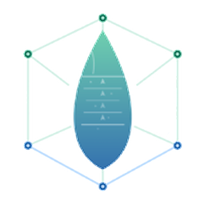
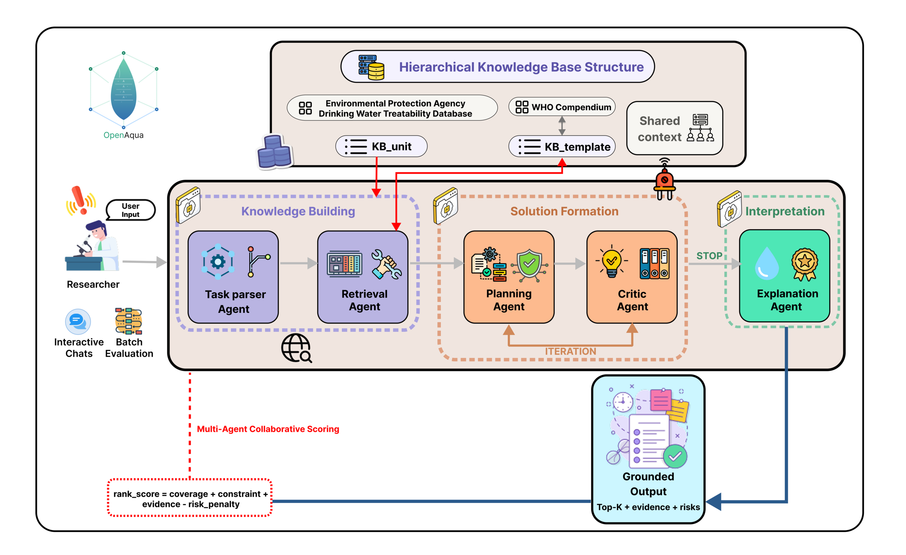

<p align="center">
  
</p>

<h1 align="center">OpenAqua Harness</h1>

<p align="center"><strong>Beta 测试版 · v0.1.0-beta.1</strong></p>

<p align="center">
  <strong>面向循证早期水处理工艺链设计的智能体化研究工作台。</strong>
</p>

<p align="center"><a href="./README.md">English</a> | <strong>简体中文</strong></p>

<p align="center">
  围绕开源 <a href="https://github.com/zhaorui-bi/OpenAqua">OpenAqua</a> 五智能体流程，提供 CLI、TUI、本地 Web、Electron 桌面端、MCP 工具、持久化任务与工程溯源。
</p>

<p align="center">
  
</p>

---

## OpenAqua Harness 是什么？

OpenAqua 是一个用于**早期水处理工艺链设计**的多智能体研究框架：

```text
任务解析 → 证据检索 → 工艺规划 → 约束审查 → 解释输出
```

OpenAqua Harness 将该 Python 研究系统封装为完整的本地工作台。它内嵌
MIT 许可的 [Kimi Code](https://github.com/MoonshotAI/kimi-code) 智能体
引擎，通过 MCP stdio 服务器暴露 OpenAqua 能力，并在终端、浏览器和
桌面端提供一致体验。

### 核心能力

| 能力 | 说明 |
| --- | --- |
| **五智能体流水线** | 查询归一化、混合检索、受控分类体系内的工艺规划、规则审查与证据绑定解释。 |
| **16 个 MCP 工具** | 覆盖状态、分类目录、推荐、检索、约束检查、索引、知识暂存、WContBench 评测与任务管理。 |
| **多种界面** | 完整 TUI、一次性 CLI、轻量 REPL、本地 Web UI 和 Electron 桌面端。 |
| **持久化工程任务** | 长任务在会话退出后仍可恢复，并记录状态、日志、输出、输入哈希、JSON 载荷哈希与请求指纹。 |
| **双模型层** | Harness 对话智能体使用 API 提供方；OpenAqua 后端可选使用 `OPENROUTER_API_KEY`。 |
| **本地优先安全设计** | 私有配置、原子写入、严格路径处理、无 shell 拼接、有界输出与默认回环地址 Web 服务。 |

> [!IMPORTANT]
> OpenAqua 输出属于早期工程决策支持，不是最终工艺设计、法规合规证明或性能保证。
> 实施前必须经过专业人员审核、适用法规审查、可处理性试验、中试及场地化工程设计。

## 环境要求

- Node.js **24.15.0 或更高版本**
- npm **12**
- OpenAqua 后端需要 Python **3.10 或更高版本**
- 本地 OpenAqua 源码仓库
- 已下载的 OpenAqua 处理后知识库与生成的索引
- macOS、Linux 或 Windows

## 快速开始

### 1. 安装 Harness

```bash
git clone https://github.com/zhaorui-bi/OpenAqua-Harness.git
cd OpenAqua-Harness
npm ci
npm run setup
```

### 2. 安装 OpenAqua

```bash
git clone https://github.com/zhaorui-bi/OpenAqua.git
cd OpenAqua
git checkout 0e3990817946f1786828fabbfa9ba4bc06af96e8
cd water_treatment_agent
python3 -m venv .venv
source .venv/bin/activate                 # Windows: .venv\Scripts\activate
python -m pip install -r requirements.txt
```

从 [Hugging Face](https://huggingface.co/datasets/zhaorui-bi/OpenAqua)
下载处理后知识库和 WContBench：

```bash
python -m pip install -U huggingface_hub
hf download zhaorui-bi/OpenAqua data.zip WContBench/ \
  --repo-type dataset \
  --revision cc2d3c620e8ada7c62fa922cf3a827d8b42889e3 \
  --local-dir ../hf_openaqua

unzip ../hf_openaqua/data.zip -d .
```

压缩包本身已包含顶层 `data/` 目录，应解压到 `water_treatment_agent`，不要解压到已有的 `data/` 目录，否则会形成错误的 `data/data/` 路径。上述 Git 与 Hugging Face 修订版是 `0.1.0-beta.1` 的验证基线；若主动升级，请记录新修订版并重新验证。保留 `../hf_openaqua/WContBench/` 用于评测；`RawData.zip` 为可选原始爬取数据。

### 3. 配置两个模型层

Harness 智能体需要一个对话模型。OpenAqua 后端可选接入 OpenRouter；未设置时会使用规则/模板回退。

```bash
# 可选：OpenAqua 解析、规划与解释智能体
export OPENROUTER_API_KEY="..."
export OPENAQUA_OPENROUTER_MODEL="anthropic/claude-3.5-sonnet"  # 可选：统一覆盖
# 也可分别设置 OPENAQUA_DEFAULT_MODEL、OPENAQUA_PLANNER_MODEL、
# OPENAQUA_EXPLANATION_MODEL。

# Harness 对话模型示例
export DEEPSEEK_API_KEY="..."
cd /path/to/OpenAqua-Harness
./bin/openaqua onboard \
  --provider deepseek \
  --api-key-env DEEPSEEK_API_KEY \
  --openaqua-repo /path/to/OpenAqua
```

也可直接运行交互式向导：

```bash
./bin/openaqua onboard
```

### 4. 验证并构建索引

```bash
./bin/openaqua doctor --probe
./bin/openaqua tools
./bin/openaqua run "检查 OpenAqua 状态；若知识库已下载但索引缺失，则构建索引。"
```

### 5. 启动界面

```bash
./bin/openaqua                                      # 完整 TUI
./bin/openaqua run "为含砷地下水推荐处理工艺链"
./bin/openaqua chat                                 # 轻量 REPL
./bin/openaqua web                                  # 本地 Web UI
npm start                                            # Electron 桌面端
```

Windows 用户请使用 `npm run cli -- <命令>` 代替 `./bin/openaqua`。

## 推荐的查询方式

优先提供结构化、带单位的信息，例如：

```text
请使用 OpenAqua 评估砷浓度为 150 µg/L 的地下水。
目标为 ≤10 µg/L（WHO），预算低、运维技能低、无法处置浓水，且用于饮用。
先归一化查询并检索证据，再推荐 3 条工艺链，展示约束修订、风险和不确定性，保存 JSON 结果。
```

智能体应保留原始单位、检查分类体系和索引状态、启动可恢复任务，并返回任务 ID 和输出路径，而不是虚构去除率或合规结论。

## CLI 命令

| 命令 | 用途 |
| --- | --- |
| `openaqua` | 启动品牌化交互式 TUI。 |
| `openaqua run "<提示词>"` | 执行一次智能体任务并流式输出。 |
| `openaqua chat` | 启动轻量持久对话。 |
| `openaqua web [选项]` | 启动带令牌的本地 Web UI。 |
| `openaqua onboard [选项]` | 配置主目录、模型、后端、MCP 与技能。 |
| `openaqua doctor [--json] [--probe]` | 检查运行时、存储、模型、资源、MCP、技能与 OpenAqua 健康状态。 |
| `openaqua tools [--json]` | 列出工具、参数和安全注解。 |
| `openaqua info` | 输出版本及解析后的路径。 |

常用 onboarding 参数包括 `--openaqua-repo DIR`、
`--openaqua-command COMMAND`、`--provider`、`--api-key-env`、`--model` 和
`--base-url`。

## MCP 工具

| 工具 | 用途 |
| --- | --- |
| `openaqua_status` | 检查 Python、依赖、OpenAqua 版本、数据、索引和 OpenRouter。 |
| `openaqua_catalog` | 搜索标准污染物和处理单元名称。 |
| `openaqua_normalize_query` | 仅执行解析与分类体系归一化。 |
| `openaqua_recommend` | 执行完整五智能体流程。 |
| `openaqua_retrieve_evidence` | 返回归一化查询以及单元级/案例级证据。 |
| `openaqua_check_constraints` | 对候选工艺链执行分类、消毒、浓水和能耗规则。 |
| `openaqua_build_indexes` | 重建语料与 BM25 索引。 |
| `openaqua_ingest_knowledge` | 暂存 `kb_unit`/`kb_case` 记录并可选重建。 |
| `openaqua_evaluate_trains` | 运行 WContBench 工艺链指标。 |
| `openaqua_evaluate_retrieval` | 运行 WContBench 检索指标。 |
| `openaqua_job_*` | 恢复任务、读取状态/清单/日志/产物或取消任务。 |

## 后端解析

Harness 按以下顺序查找兼容后端：

1. `OPENAQUA_COMMAND`；
2. `~/.openaqua/openaqua.json` 中的 `command` 或 `repo`；
3. `OPENAQUA_REPO`；
4. `PATH` 上兼容适配器协议的 `openaqua` 命令。

仓库模式下，Python 查找顺序为：`OPENAQUA_PYTHON`、仓库根目录虚拟环境、
`water_treatment_agent/` 下虚拟环境、系统 `python3/python`（Windows 还支持 `py -3`）。

## 持久化任务与溯源

推荐、检索、索引构建、知识暂存和评测都以后台任务运行。每个任务写入：

```text
<workdir>/openaqua-jobs/<jobId>/
├── job.json
├── run.log
├── completion.json
├── exit.code
└── run-manifest.json
```

`run-manifest.json` 记录已校验参数、后端/运行时身份、常规文件 SHA-256、
内联 JSON 载荷哈希、输出路径和 `requestSha256`。该指纹只代表“请求相同”，
不代表 Hugging Face 数据、索引、远程模型响应或工程结果完全相同。

## 已知边界

- 本仓库不打包 OpenAqua Python 依赖或 Hugging Face 数据。
- 未设置 `OPENROUTER_API_KEY` 时，自然语言抽取能力会下降；测量数据应优先用结构化字段提供。
- `openaqua_ingest_knowledge` 遵循 OpenAqua v1 的暂存行为；原版索引器不会自动把暂存记录合并进规范知识库。
- OpenAqua 排名分数不是处理成功概率。
- WContBench 衡量与基准参考的一致性，不代表法规合规或现场性能。

## 开发与质量检查

```bash
npm run check
npm run build
npm run pack
npm run smoke:desktop
npm run release:check
```

## 文档

- [快速上手](./docs/zh-CN/QUICKSTART.md)
- [常见问题](./docs/zh-CN/FAQ.md)
- [故障排查](./docs/zh-CN/TROUBLESHOOTING.md)
- [架构说明（英文）](./docs/ARCHITECTURE.md)
- [工程工作流规范（英文）](./docs/SCIENTIFIC_WORKFLOWS.md)
- [English README](./README.md)

## 署名与引用

OpenAqua Harness 产品层采用 MIT 许可证。vendored 引擎基于 MIT 许可的
Kimi Code。OpenAqua 是外部 MIT 许可项目；使用其科学流程时，请引用
OpenAqua 论文以及实际使用的软件、数据和模型版本：

> Liu H., Jiang Z., Zhong H., Li J., Pang W., Yuan Y. OpenAqua: an automated
> multi-agent framework for early-stage water treatment train design with
> retrieval augmentation and critic-based refinement. *Water Research* (2026).
> <https://doi.org/10.1016/j.watres.2026.126761>

详见 [CITATION.cff](./CITATION.cff)、[THIRD_PARTY_NOTICES.md](./THIRD_PARTY_NOTICES.md)
与 [SBOM.spdx.json](./SBOM.spdx.json)。

OpenAqua Harness 是独立产品，不得表述为 OpenAqua 或 Kimi Code 官方客户端。
