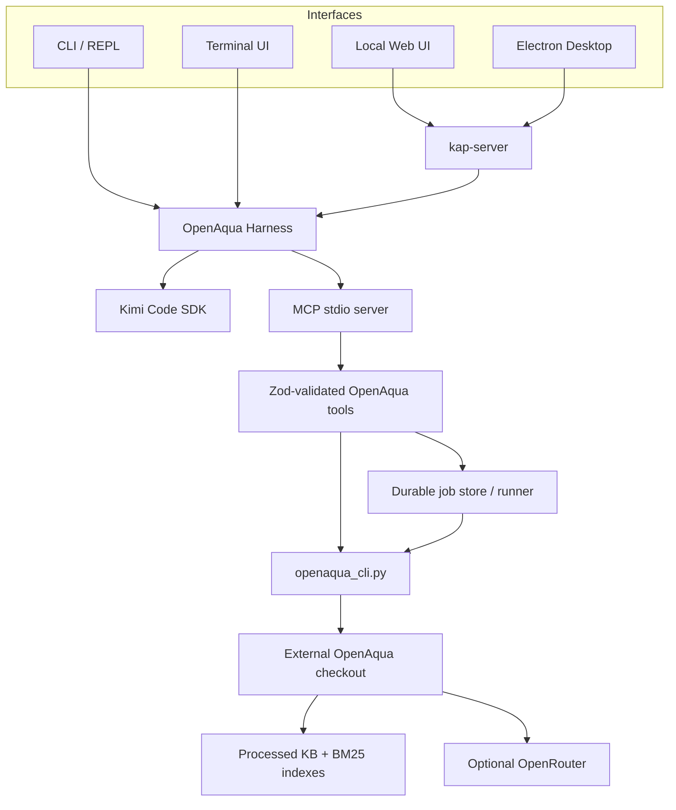

# Architecture

OpenAqua Harness combines four layers:

1. a branded CLI/TUI/Web/Electron product;
2. the vendored Kimi Code agent engine;
3. an MCP tool and durable-job layer;
4. a bundled Python adapter over an external OpenAqua checkout.

## Runtime topology



CLI sessions attach the MCP server directly to the SDK session. Web and desktop
sessions register it in `<home>/mcp.json`, allowing kap-server sessions to load
the same tool surface.

## Python adapter boundary

OpenAqua does not expose one unified CLI, so the Harness ships
`backend/openaqua_cli.py`. It adds a stable JSON-oriented command contract:

```text
health, catalog, normalize, recommend, retrieve, check-constraints,
build-indexes, ingest, evaluate-trains, evaluate-retrieval
```

The adapter prepends `water_treatment_agent/` to `sys.path`, sets the working
directory expected by OpenAqua, invokes its public agents/pipeline/evaluation
scripts, serializes Pydantic models, and writes result JSON atomically.

The adapter does not vendor or modify the external OpenAqua source tree. Backend
resolution is implemented in `src/openaqua/backend.ts` and supports:

- `OPENAQUA_COMMAND`;
- `~/.openaqua/openaqua.json`;
- `OPENAQUA_REPO`;
- an adapter-compatible executable on `PATH`.

Repository mode finds an explicit `OPENAQUA_PYTHON`, recognized virtual
environments, or a system Python interpreter.

## Tool execution model

Read-only/short operations run synchronously with bounded output and timeout:

- status;
- taxonomy catalog;
- query normalization;
- candidate constraint checking.

Longer or output-producing operations run as durable jobs:

- recommendation;
- evidence retrieval;
- index building;
- knowledge staging;
- treatment-train evaluation;
- retrieval evaluation.

`src/openaqua/tools.ts` defines Zod schemas, maps camelCase MCP input to the
adapter’s snake_case JSON, resolves workspace-relative paths, performs input
preflight, and assigns MCP safety annotations.

## Durable job lifecycle

`src/openaqua/jobs.ts` creates a private job directory, writes runner config and
provenance atomically, then launches `dist/job-runner.mjs` as an independent
process. The runner removes its transient config, starts the backend without a
shell, streams stdout/stderr to `run.log`, forwards cancellation signals, and
writes completion metadata plus exit code.

```text
<jobsRoot>/<jobId>/
├── job.json
├── run.log
├── completion.json
├── exit.code
└── run-manifest.json
```

Job discovery validates IDs and rejects symbolic-link records. Log reads are
bounded by bytes/lines and support raw, error, event, tail, and cursor modes.
Artifact listing is rooted at the explicit `--output` path and never follows
symbolic links.

## Engineering provenance

`src/openaqua/provenance.ts` creates a schema-versioned request identity:

- tool and operation;
- requested JSON-safe parameters;
- backend source/argv and adapter-reported version/revision;
- regular-file metadata and SHA-256 hashes;
- benchmark-directory identity without recursive hashing;
- inline query/candidate payload hashes;
- runtime identity and configured output;
- canonical request fingerprint.

The fingerprint does not include remote model responses, recursive dataset
contents, or generated output. It is intentionally a request identity, not a
claim of deterministic engineering equivalence.

## Desktop topology and security

The Electron main process supervises one local Web server child and loads only
its authenticated loopback URL.

- `sandbox: true`, `contextIsolation: true`, `nodeIntegration: false`;
- renderer permissions and webviews denied;
- navigation restricted to the current local-server origin;
- external `http:`, `https:`, and `mailto:` URLs delegated to the OS;
- bearer URL fragments redacted from logs;
- startup and shutdown bounded by timeouts;
- POSIX process groups / Windows process trees terminated on restart or quit;
- production developer tools hidden unless `OPENAQUA_DEBUG=1`.

Desktop configuration and Harness home files use private permissions and atomic
writes. The packaged app can import an existing `~/.openaqua` provider/backend
configuration without overwriting an initialized desktop home.

## Packaging layout

Electron Builder places `main.js` in `app.asar` and ships the following as
resources:

```text
harness/dist/
harness/skills/
harness/backend/
web-ui/
brand/logo.png
licenses/
```

The Python adapter is therefore available in packaged applications, while the
user-selected OpenAqua checkout and data remain external.

## Generated Web UI

`engine/apps/openaqua-harness/scripts/sync-web-ui.mjs` copies the upstream
prebuilt Web UI and applies deterministic product text, SVG, provider-flow, and
CSS substitutions. `theme/openaqua.css` is appended together with self-hosted
fonts. Generated `web-ui/` files are not edited manually.

## Configuration separation

- `OPENAQUA_HOME` stores Harness model/MCP/backend configuration.
- `OPENAQUA_WORKDIR` is the default agent workspace and output base.
- `OPENAQUA_JOBS_DIR` controls durable job metadata.
- `OPENAQUA_REPO` points to external scientific code.
- `OPENROUTER_API_KEY` is consumed by OpenAqua, not by the Harness provider
  subsystem unless separately configured there.

Directly launched Kimi Code remains independent because the branded host is
activated only when `OPENAQUA_TUI=1` or the OpenAqua host identity is supplied.

## Quality gates

`npm run check` covers JavaScript syntax, linting, product typechecking, unit
and integration tests, dual-host TUI regressions, MCP/Web smoke tests, license
freshness, and repository invariants. Native desktop workflows additionally
build and launch packaged applications on macOS, Windows, and Linux.
