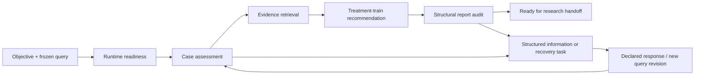

# Durable water-treatment research tasks

Research tasks connect a case, its information needs, evidence retrieval,
recommendations, and report audit across sessions. The six `openaqua_research_*`
tools expose the same controller as `openaqua research`; the original 18 tools
remain available for independent operations. The controller's gates apply to
this research workflow, not to direct calls to `openaqua_recommend`.

## From case to handoff



Each task keeps its declared scope (`mandate`), frozen query revisions,
assignments to durable jobs, event history, open and resolved attention items,
and scientific outcome. A task is a research work item; an assignment is one
execution attempt. A backend job succeeding does not make the research task
ready.

| State | Meaning |
| --- | --- |
| `open` | Created or eligible for its next stage. |
| `running` | A durable assignment needs reconciliation. |
| `waiting` | Information, recovery, or review is required; read `attention` and `nextAction`. |
| `ready` | The workflow reached handoff with a passing structural audit. |
| `cancelled` | Cancelled work cannot be resumed by `advance`. |

`ready` is not expert approval, proof of evidence applicability, a performance
guarantee, or regulatory compliance. The report audit checks structure and
declared support; it does not establish semantic entailment or site suitability.

## Start a task without a conversational model

The controller reads JSON and returns JSON. Task creation, listing, status, and
responses do not require a Harness chat-model session. Backend execution still
uses the configured OpenAqua runtime and, where configured, its model services.
Install the backend and data using the [quick start](./QUICKSTART.md) first.

Save the following **synthetic format example** as `case.json`. Replace it with
measured case data and declared targets for an actual study; absent data must
remain absent.

```json
{
  "source_water": "groundwater",
  "water_quality": {
    "arsenic_ug_L": 150,
    "pH": 7.2,
    "turbidity_NTU": 1,
    "extra": {"arsenic_speciation": "As(V), synthetic example"}
  },
  "contaminants": ["arsenic"],
  "treatment_targets": {"arsenic_ug_L": 10},
  "constraints": {
    "budget": "low",
    "energy": "low",
    "brine_disposal": false,
    "operator_skill": "low",
    "use_for_drinking": true,
    "chemical_dosing_allowed": true,
    "extra": {"design_flow_m3_day": 25}
  },
  "context": "Synthetic screening example; numeric target supplied for comparison, not a regulatory determination."
}
```

Save `research-create.json`:

```json
{
  "requestId": "arsenic-screening-001",
  "objective": "Compare three early-stage treatment trains for the declared groundwater case, retaining evidence, constraints and uncertainty.",
  "queryFile": "case.json",
  "topK": 3,
  "maxJobs": 4
}
```

```bash
./bin/openaqua research create --input research-create.json
./bin/openaqua research list
```

Creation freezes the input and returns the task, including `id`, `version`,
`stage`, and `nextAction`; it starts no backend job. Reusing the same `requestId`
in the same physical workspace returns the same task only for the same request.
Use a new request ID for an independent study. Query files use upstream
snake_case, including `water_quality` and `treatment_targets`.

## Advance and recover

Replace the example ID below with the returned `id`. Supply the latest returned
`version` when requesting a change; a stale version is refused.

```bash
./bin/openaqua research status --id research_0123456789abcdef01234567
./bin/openaqua research advance --id research_0123456789abcdef01234567 --expected-version 1
```

`advance` reconciles the current assignment and advances only when that stage's
gate permits. A launched job continues independently of the CLI or session.
Call `advance` again after it finishes to reconcile its result and move onward;
reading `status` or `list` alone never executes or refreshes work. A task is not
an always-running scheduler, and an interrupted client need not restart a job.
Return the task ID, current job ID, and next action instead of holding the
conversation open with repeated polling.

Before handing off a `ready` task, call `advance` to recheck its frozen inputs,
captured artifact hashes, and audit coverage without launching new jobs.
Changed or incomplete artifacts revoke readiness and create an integrity item;
an unchanged handoff keeps its version. `status` remains a persisted snapshot.

Records and frozen artifacts live under
`<jobsRoot>/research/<taskId>/`. Task responses retain a bounded recent event
window; `eventCount` and `eventsTruncated` identify when older event details
have been omitted. Keep the assignment manifests and bounded job-log reads for
execution evidence.

Running or unknown jobs are not automatically relaunched. The controller keeps
job and output identities and refuses to treat a missing, malformed, or changed
result as a verified stage completion. The default budget is **four backend
jobs**, with a maximum of **16**; retries and revised-case reassessments consume
that budget too. No automatic index rebuild, knowledge ingestion, benchmark
campaign, or external message delivery is part of advancing a task.

## Respond to structured attention

Read the open item in `attention`, its `allowedActions`, and `nextAction` before
responding. Use its exact `id` as `attentionId` and the task's current `version`
as `expectedVersion`. Responses record the caller's reason; they are
**caller-declared decisions, not authenticated human sign-off**.

| Response | Permitted use |
| --- | --- |
| `amend_query` | Supply a new query file to address missing case data; preserve the old revision and rerun applicable gates. |
| `continue_screening` | Continue conditional screening for eligible high-priority information gaps, with a reason. Critical blockers cannot be waived. |
| `retry` | Retry an eligible, confirmed terminal failure or recheck runtime readiness within the existing budget. Running and unknown jobs are not retryable. |

For a case waiting on missing information, obtain the documented data, save a new file
`case-revised.json` and a response file:

```json
{
  "taskId": "research_0123456789abcdef01234567",
  "attentionId": "REPLACE_WITH_OPEN_ATTENTION_ID",
  "expectedVersion": 3,
  "action": "amend_query",
  "queryFile": "case-revised.json",
  "reason": "Added documented site flow and measured arsenic speciation; original measured concentrations are retained."
}
```

```bash
./bin/openaqua research respond --input research-response.json
```

The IDs and version above illustrate the format; use the values actually
returned for your task. Neither `continue_screening` nor a written response can
turn an audit `fail` or `warn` into `ready`. Preserve unresolved limitations in
the handoff and arrange independent scientific review.

## CLI and MCP contract

Every CLI action accepts `--input FILE` with the corresponding MCP JSON schema.
Input must be a regular UTF-8 JSON object of at most 64 KiB; unknown command fields are
rejected. Relative input and query paths resolve from `OPENAQUA_WORKDIR`, or the
current workspace when unset. `--home DIR` selects Harness backend configuration.

| CLI action / MCP tool | Input |
| --- | --- |
| `create` / `openaqua_research_create` | `requestId`, `objective`, `queryFile`, optional `topK` (1–10), `maxJobs` (1–16). |
| `status` / `openaqua_research_status` | `taskId`; CLI also accepts `--id ID`. |
| `list` / `openaqua_research_list` | Optional `status` and `limit` (1–100); CLI needs no input for defaults. |
| `advance` / `openaqua_research_advance` | `taskId`, optional `expectedVersion`; CLI also accepts `--id ID [--expected-version N]`. |
| `respond` / `openaqua_research_respond` | `taskId`, `attentionId`, `expectedVersion`, `action`, `reason`, optional `queryFile`. |
| `cancel` / `openaqua_research_cancel` | `taskId`, `reason`, optional `expectedVersion`. |

Do not combine `--input` with `--id` or `--expected-version`. Task versions are
positive integers. Five actions return the task at the JSON top level; `list`
returns `{ "tasks": [...], "returned": N }` with compact task summaries, current
job IDs, budgets, and open attention IDs. It omits artifacts and event history;
use `status` for the full task. Truncated objective or next-action text is
explicitly flagged. A controller/input refusal returns
an error object and a nonzero exit status; command-grammar errors print the CLI
usage to stderr. Confirmed cancellation retains the task's
records and stops its active job; later advancement cannot resume it. If the
original job's terminal state cannot be confirmed, the task waits for inspection
instead of reporting a successful cancellation.

## Design reference

The design learns from the MIT-licensed research prototype
[`deepseek-ai/dsh-superagent-prototype` at `6337fc8`](https://github.com/deepseek-ai/dsh-superagent-prototype/tree/6337fc823ce20251c8de8085948165c81aaa701e).
OpenAqua implements its own domain-specific controller; no source code or new
runtime dependency from that project is bundled.

| Reference concept | OpenAqua adaptation |
| --- | --- |
| [Ticket and Assignment](https://github.com/deepseek-ai/dsh-superagent-prototype/blob/6337fc823ce20251c8de8085948165c81aaa701e/src/core/model.ts) | A durable research work item with separate backend-job attempts. |
| [Mandate and context](https://github.com/deepseek-ai/dsh-superagent-prototype/blob/6337fc823ce20251c8de8085948165c81aaa701e/docs/002-authorization.md) | Declared scope and input revisions; material received as context grants no new authority. |
| [Attention and stage](https://github.com/deepseek-ai/dsh-superagent-prototype/blob/6337fc823ce20251c8de8085948165c81aaa701e/src/core/stage.ts) | Explicit missing information, recovery, or review actions instead of free-text status guessing. |
| [Recovery and stored effects](https://github.com/deepseek-ai/dsh-superagent-prototype/blob/6337fc823ce20251c8de8085948165c81aaa701e/docs/003-execution.md) | Persisted assignments, reconciliation, bounded retries, and preserved job identity. |

GitHub/Feishu listeners, cross-thread subscriptions, account admission tables,
outbound message delivery, and the prototype's deployment presets are not
ported. Local task declarations are not that project's verified Source
authorization, and workspace separation is not an OS sandbox. This controller
adds computational workflow checks; it does not establish a new scientific
validation method or independent human approval.
